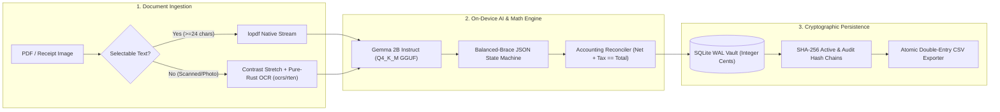

# 🛡️ VaultLedger

### **Air-Gapped Local AI Financial Extraction & Cryptographic Double-Entry Ledger**

*Zero Cloud. Zero Telemetry. 100% On-Device Rust + Quantized Gemma 2B Inference.*

---

## ⚡ Overview

Freelancers, auditors, and privacy-critical businesses shouldn't have to upload sensitive invoices, tax IDs, and banking records to third-party cloud APIs just to automate bookkeeping.

**VaultLedger** is a strictly **air-gapped, local-first desktop application** engineered in **Rust** and **Tauri v2**. It ingests messy PDF invoices or receipt photos, extracts structured accounting line items using an embedded **Google Gemma 2B (Q4_K_M GGUF)** model running via pure-Rust **Candle** tensors, anchors every record into a **SHA-256 tamper-evident SQLite database**, and exports balanced **Double-Entry General Ledger CSVs**.

### 🔒 The Air-Gap Guarantee

* **Compile-Time Network Ban:** `build.rs` inspects the resolved Cargo dependency graph at compile time and panics if any HTTP/network crate (`reqwest`, `curl`, `hyper`, `ureq`) is present.
* **Memory Safety:** Compiled with `#![forbid(unsafe_code)]` across the entire Rust codebase.
* **Locked CSP:** Tauri v2 capability sandboxing restricts IPC strictly to local memory with external origins blocked.

---

## 🏗️ System Architecture



---

## ✨ Key Engineering Features

| Subsystem | Technical Implementation | Why It Matters |
| --- | --- | --- |
| **Hybrid Document Ingestion** | `lopdf` + `image` + `ocrs` (`rten` neural weights) | Extracts native PDF text in milliseconds; automatically falls back to contrast-enhanced offline OCR for scanned receipts. |
| **Embedded GGUF Inference** | `candle-core` + `candle-transformers` | Runs quantized **Gemma 2B Instruct** locally on CPU/Metal/CUDA with real-time token streaming over Tauri v2 events. |
| **Deterministic Accounting Math** | `schemars` + Fixed-Point Integer Cents (`i64`) | Enforces ISO-8601 dates, ISO-4217 currencies (`MAD`, `USD`, `EUR`, etc.), and reconciles `net + tax == total` without IEEE-754 float drift. |
| **Tamper-Evident SQLite Vault** | `rusqlite` (WAL mode) + `sha2` | Every row is cryptographically chained (`prev_chain_hash -> chain_hash`) alongside an append-only `ledger_audit_events` log. Out-of-band DB edits trigger an immediate tamper alert. |
| **Double-Entry Tax Exporter** | `csv` + Atomic Temp-Write & `sync_all` | Expands each invoice into balanced **DEBIT** (Expense GL + `2210-VAT-INPUT`) and **CREDIT** (`2000-AP-CLEARING`) journal rows and verifies the trial balance before atomic file rename. |

---

## 📊 General Ledger Account Mapping

Every extracted invoice is automatically classified into a standard General Ledger chart-of-accounts code and expanded into balanced double-entry legs upon export:

* **`6110-SAAS`** — Software & Cloud Subscriptions (`SoftwareAndSaaS`)
* **`6120-EQUIP`** — Computer Hardware & Equipment (`HardwareAndEquipment`)
* **`6130-SUPPLIES`** — Office Supplies & Stationery (`OfficeSupplies`)
* **`6210-TRAVEL`** — Business Travel & Transport (`TravelAndTransport`)
* **`6220-MEALS`** — Meals & Client Entertainment (`MealsAndEntertainment`)
* **`6310-PROFSERV`** — Legal, Accounting & Consulting (`ProfessionalServices`)
* **`6410-UTIL`** — Telecommunications & Utilities (`Utilities`)
* **`6990-MISC`** — Miscellaneous Operating Expenses (`Other`)
* **`2210-VAT-INPUT`** — Recoverable Input VAT / Sales Tax *(Auto-generated Debit leg when `tax_amount > 0`)*
* **`2000-AP-CLEARING`** — Accounts Payable / Freelance Clearing *(Auto-generated Credit leg for `total_amount`)*

---

## 📂 Repository Structure

```text
vault-ledger/
├── index.html                  # Obsidian Fintech UI & Glassmorphic Dashboard
├── package.json                # Vite + TypeScript + Tauri v2 CLI scripts
├── tsconfig.json               # Strict TypeScript compiler configuration
├── vite.config.ts              # Vite bundler config
├── src/
│   ├── main.ts                 # Tauri v2 IPC bindings, live token stream listener, KPI & modal logic
│   └── styles.css              # Design tokens and responsive layout rules
└── src-tauri/
    ├── Cargo.toml              # Pure-Rust dependency manifest (#![forbid(unsafe_code)])
    ├── build.rs                # Compile-time air-gap enforcement gate
    ├── tauri.conf.json         # Strict CSP & bundled local resource configuration
    ├── capabilities/
    │   └── airgap.json         # Zero-network Tauri v2 permission capability
    ├── resources/
    │   ├── models/             # Local Gemma 2B Q4_K_M GGUF & tokenizer.json
    │   └── ocr/                # Local text-detection.rten & text-recognition.rten
    └── src/
        ├── main.rs             # Binary entrypoint
        ├── lib.rs              # Multi-threaded async Tauri v2 IPC command handlers
        ├── error.rs            # Explicit thiserror hierarchy & IPC diagnostic serialization
        ├── schema.rs           # ExtractedDocument, GL codes, math reconciler & SHA-256 digests
        ├── ingestion.rs        # PDF stream parser, contrast preprocessor & pure-Rust OCR fallback
        ├── inference.rs        # Quantized Gemma 2B GGUF runner & balanced-brace JSON parser
        ├── storage.rs          # WAL SQLite store & cryptographic SHA-256 chain verifier
        └── exporter.rs         # Atomic double-entry CSV generator with trial-balance check

```

---

## 🚀 Getting Started

### 1. Prerequisites

Ensure you have **Rust (1.79+)** and **Node.js (18+)** installed.

* **Arch Linux:**
```bash
sudo pacman -S --needed webkit2gtk-4.1 base-devel curl wget file openssl appmenu-gtk-module libappindicator-gtk3 librsvg nodejs npm rustup
rustup default stable

```


### 2. Run in Development Mode

```bash
npm install
npm run tauri dev

```

### 3. Build Production Desktop Bundle

```bash
npm run tauri build

```

---

---

## 📄 License

Distributed under the MIT License.
