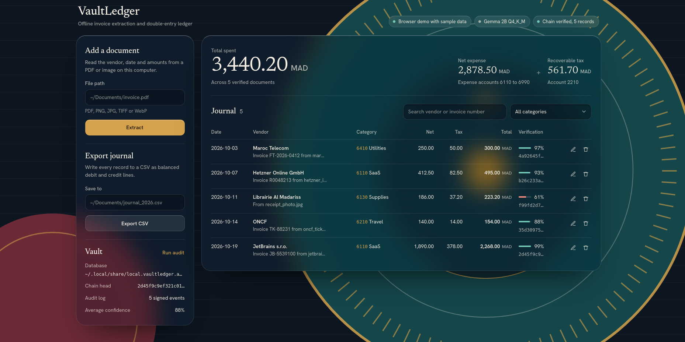
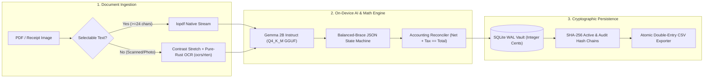

# VaultLedger

Local-first, air-gapped desktop app built with Rust and Tauri v2. Extracts line items from PDF invoices and receipt photos using an on-device quantized Gemma 2B model (Candle), stores records in a SHA-256 hash-chained SQLite database, and exports balanced double-entry general ledger CSVs.

## Air-Gap Enforcement

* **Direct Dependency & Build-Time Enforcement:** `src-tauri/Cargo.toml` declares zero HTTP/network client crates and explicitly disables `tokenizers`' default `http` feature (`default-features = false, features = ["fancy-regex"]`). At compile time, `src-tauri/build.rs` inspects `src-tauri/Cargo.toml` dependency tables and build environment flags (`DEP_CURL*`, `CARGO_FEATURE_HTTP*`), failing the build if any forbidden HTTP/network client crate (`reqwest`, `curl`, `curl-sys`, `hyper`, `ureq`, `isahc`, `surf`, `tauri-plugin-http`) is added.
  * *Transparency note on `Cargo.lock`:* Because Cargo resolves all platform targets into `Cargo.lock`, `reqwest` and `hyper` appear in `src-tauri/Cargo.lock` as mobile-only (`android`/iOS) transitive dependencies of `tauri`. On desktop targets (Linux, macOS, Windows), neither `reqwest` nor `hyper` is compiled into the binary (verifiable via `cargo tree -i reqwest` / `cargo tree -i hyper`); Tauri only compiles the transport-free `http` types crate for local `ipc://` and `asset://` protocol handling.
* **Memory Safety:** Compiled with `#![forbid(unsafe_code)]` across the entire VaultLedger Rust codebase (enforced in both `Cargo.toml` `[lints.rust]` and module attributes).
* **Locked CSP & Capabilities:** Tauri v2 capability sandboxing (`src-tauri/capabilities/airgap.json`) and strict CSP (`src-tauri/tauri.conf.json`) restrict IPC strictly to local `ipc://` and `asset://` origins with external origins blocked and no HTTP or shell plugins enabled.

## Demo



Live site: [https://tahaenasraoui-debug.github.io/vault-ledger/](https://tahaenasraoui-debug.github.io/vault-ledger/)

## System Architecture



## Subsystems

| Subsystem | Technical Implementation | Behavior |
| --- | --- | --- |
| **Hybrid Document Ingestion** | `lopdf` + `image` + `ocrs` (`rten` neural weights) | Extracts native PDF text in milliseconds; automatically falls back to contrast-enhanced offline OCR for scanned receipts. |
| **Embedded GGUF Inference** | `candle-core` + `candle-transformers` | Runs quantized **Gemma 2B Instruct** locally on CPU/Metal/CUDA with real-time token streaming over Tauri v2 events. |
| **Deterministic Accounting Math** | `schemars` + Fixed-Point Integer Cents (`i64`) | Enforces ISO-8601 dates, ISO-4217 currencies (`MAD`, `USD`, `EUR`, etc.), and reconciles `net + tax == total` without IEEE-754 float drift. |
| **Tamper-Evident SQLite Vault** | `rusqlite` (WAL mode) + `sha2` | Every row is cryptographically chained (`prev_chain_hash -> chain_hash`) alongside an append-only `ledger_audit_events` log. Out-of-band DB edits trigger an immediate tamper alert. |
| **Double-Entry Tax Exporter** | `csv` + Atomic Temp-Write & `sync_all` | Expands each invoice into balanced **DEBIT** (Expense GL + `2210-VAT-INPUT`) and **CREDIT** (`2000-AP-CLEARING`) journal rows and verifies the trial balance before atomic file rename. |

## General Ledger Account Mapping

Every extracted invoice is automatically classified into a standard General Ledger chart-of-accounts code and expanded into balanced double-entry legs upon export:

* **`6110-SAAS`** — Software & Cloud Subscriptions (`SoftwareAndSaaS`)
* **`6120-EQUIP`** — Computer Hardware & Equipment (`HardwareAndEquipment`)
* **`6130-SUPPLIES`** — Office Supplies & Stationery (`OfficeSupplies`)
* **`6210-TRAVEL`** — Business Travel & Transport (`TravelAndTransport`)
* **`6220-MEALS`** — Meals & Client Entertainment (`MealsAndEntertainment`)
* **`6310-PROFSERV`** — Legal, Accounting & Consulting (`ProfessionalServices`)
* **`6410-UTIL`** — Telecommunications & Utilities (`Utilities`)
* **`6990-MISC`** — Miscellaneous Operating Expenses (`Other`)
* **`2210-VAT-INPUT`** — Recoverable Input VAT / Sales Tax *(Auto-generated Debit leg when `tax_amount > 0`)*
* **`2000-AP-CLEARING`** — Accounts Payable / Freelance Clearing *(Auto-generated Credit leg for `total_amount`)*

## Repository Structure

```text
vault-ledger/
├── index.html                  # Frontend HTML entrypoint
├── package.json                # Vite + TypeScript + Tauri v2 CLI scripts
├── tsconfig.json               # Strict TypeScript compiler configuration
├── vite.config.ts              # Vite bundler config
├── src/
│   ├── main.ts                 # Tauri v2 IPC bindings, live token stream listener, KPI & modal logic
│   └── styles.css              # Design tokens and responsive layout rules
└── src-tauri/
    ├── Cargo.toml              # Pure-Rust dependency manifest (#![forbid(unsafe_code)])
    ├── build.rs                # Compile-time air-gap enforcement gate
    ├── tauri.conf.json         # Strict CSP & bundled local resource configuration
    ├── capabilities/
    │   └── airgap.json         # Zero-network Tauri v2 permission capability
    ├── resources/
    │   ├── models/             # Local Gemma 2B Q4_K_M GGUF & tokenizer.json
    │   └── ocr/                # Local text-detection.rten & text-recognition.rten
    └── src/
        ├── main.rs             # Binary entrypoint
        ├── lib.rs              # Multi-threaded async Tauri v2 IPC command handlers
        ├── error.rs            # Explicit thiserror hierarchy & IPC diagnostic serialization
        ├── schema.rs           # ExtractedDocument, GL codes, math reconciler & SHA-256 digests
        ├── ingestion.rs        # PDF stream parser, contrast preprocessor & pure-Rust OCR fallback
        ├── inference.rs        # Quantized Gemma 2B GGUF runner & balanced-brace JSON parser
        ├── storage.rs          # WAL SQLite store & cryptographic SHA-256 chain verifier
        └── exporter.rs         # Atomic double-entry CSV generator with trial-balance check

```

## Getting Started

### 1. Prerequisites

Ensure you have **Rust (1.79+)** and **Node.js (18+)** installed.

* **Arch Linux system dependencies:**

```bash
sudo pacman -S --needed webkit2gtk-4.1 base-devel curl wget file openssl appmenu-gtk-module libappindicator-gtk3 librsvg nodejs npm rustup
rustup default stable
```

* **Clone the repository:**

```bash
git clone https://github.com/tahaenasraoui-debug/vault-ledger.git
cd vault-ledger
```

### 2. Download & Place Required Local Model Files

Because model weights are large and gitignored, VaultLedger expects **4 local model files** under `src-tauri/resources/` (matching `src-tauri/src/lib.rs` and `src-tauri/tauri.conf.json`) before running or bundling the Tauri desktop app:

| Required Path | Description & Source |
| --- | --- |
| `src-tauri/resources/models/gemma-2b-it-q4_k_m.gguf` | Quantized **Gemma** Instruct GGUF (`Q4_K_M`, loaded via Candle's `quantized_gemma3` GGUF runner). Obtain a compatible `Q4_K_M` Gemma GGUF from Hugging Face (after accepting Google's Gemma Terms of Use) and save it under this exact filename. |
| `src-tauri/resources/models/tokenizer.json` | Hugging Face fast tokenizer (`tokenizer.json`) from [`google/gemma-2b-it`](https://huggingface.co/google/gemma-2b-it). |
| `src-tauri/resources/ocr/text-detection.rten` | Offline OCR text-detection model from [`ocrs`](https://github.com/robertknight/ocrs). |
| `src-tauri/resources/ocr/text-recognition.rten` | Offline OCR text-recognition model from [`ocrs`](https://github.com/robertknight/ocrs). |

Create the directories and fetch the two `ocrs` OCR models:

```bash
mkdir -p src-tauri/resources/models src-tauri/resources/ocr

curl -fL -o src-tauri/resources/ocr/text-detection.rten \
  https://ocrs-models.s3-accelerate.amazonaws.com/text-detection.rten

curl -fL -o src-tauri/resources/ocr/text-recognition.rten \
  https://ocrs-models.s3-accelerate.amazonaws.com/text-recognition.rten
```

Then place `gemma-2b-it-q4_k_m.gguf` and `tokenizer.json` inside `src-tauri/resources/models/`.

> **Note:** To preview the UI in a browser without downloading the local models, run `npm ci && npm run dev` — outside the Tauri runtime, `src/demo.ts` automatically provides offline sample data.

### 3. Run in Development Mode

```bash
npm ci
npm run tauri dev
```

### 4. Build Production Desktop Bundle

```bash
npm run tauri build
```

## Contributing

Contributions, bug reports, and feature suggestions are welcome. For larger changes or new features, please open an issue first to discuss the approach before writing code.

1. Fork the repository and create a branch from `main` (e.g., `git checkout -b fix/short-description` or `feat/short-description`).
2. Keep pull requests focused on a single change and follow the existing code style.
3. Run the local checks before opening a PR:

   ```bash
   npx tsc --noEmit
   npm run build
   (cd src-tauri && cargo fmt --check && cargo clippy --all-targets -- -D warnings && cargo test)
   ```

4. Open a Pull Request describing what changed and why (include a screenshot or GIF for UI changes, and link any related issue).

Preserve the air-gap guarantee (no outbound network calls or telemetry) and never commit model weights or real financial documents.

When reporting bugs, please include steps to reproduce, expected vs. actual behavior, and your environment details (OS, Node.js, and Rust toolchain version).

## License

Distributed under the MIT License. See [LICENSE](LICENSE) for details.
